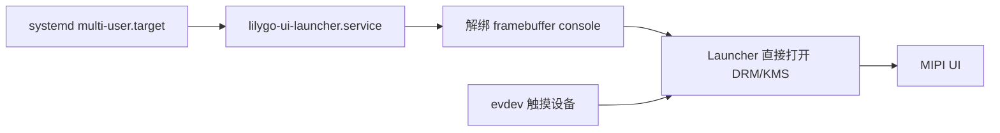
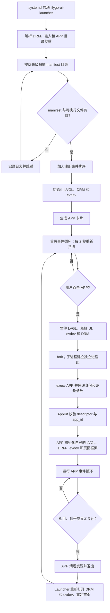

# Launcher 运行 APP 的流程与资源

本文描述 `lilygo-ui-launcher` 在无桌面系统的目标板上，从 systemd 启动、发现 APP、
响应点击、启动独立进程到恢复首页的实际流程。Launcher 与 APP 是独立进程；安装
manifest 是运行时发现协议，不表示 APP 依赖 Launcher 源码或软件包。

## 生产环境启动

目标镜像不启动 display manager、桌面环境或 compositor。Debian 包安装后将默认
target 设置为 `multi-user.target`，屏蔽 `getty@tty1.service`，并启用：

```sh
/usr/bin/lilygo-ui-launcher --display drm --drm /dev/dri/card0 \
  --input /dev/input/by-path/platform-3f205000.i2c-event
```

`lilygo-ui-launcher.service` 直接占用 DRM/KMS 和 evdev。服务启动前，
`lilygo-ui-launcher-console acquire` 暂时解绑 framebuffer console，避免内核控制台与
Launcher 同时写显示设备；服务退出后再执行 `release` 恢复绑定。Launcher 和 APP
的 stdout/stderr 均由 journald 收集。

安装脚本在 `/var/lib/lilygo-ui-launcher` 记录安装前的默认 target、已启用的
display manager 和由本包屏蔽的 getty。卸载软件包时会停用 Launcher 服务并恢复
这些状态。软件包不安装 XDG autostart 或桌面菜单入口。



## 总体流程



## APP 发现

Launcher 依次扫描以下来源，先发现的同 ID 应用优先：

1. `LAUNCHER_APP_DIRS` 中以冒号分隔的目录；
2. `--app-dir` 指定目录；
3. `$XDG_DATA_HOME/launcher/apps`，或 `$HOME/.local/share/launcher/apps`；
4. `/usr/local/share/launcher/apps`；
5. `/usr/share/launcher/apps`。

manifest 必须是普通 `.json` 文件，包含合法的 application ID、显示名、可执行路径
和顺序字段。独立 APP 包应将 128x128 PNG 安装到
`/usr/share/icons/hicolor/128x128/apps/<application-id>.png`，并通过 `icon`
字段填写绝对路径或相对 manifest 的路径。图标未提供、文件不可读或 PNG 无法识别时，
Launcher 显示内置默认图标，但仍正常发现和启动 APP。可执行文件必须存在、是普通文件
并具有执行权限。首页停留期间每 2 秒清理已消失的应用并重新扫描，安装或卸载独立
APP 包不需要重启 Launcher。

## 进程启动协议

Launcher 刷新当前帧后暂停 LVGL timer。DRM 后端会删除 evdev、Launcher UI 和
DRM display，释放设备所有权，然后 `fork()`。子进程建立独立进程组并直接
`execv()` manifest 指定的文件，不经过 shell。父进程以非阻塞 `waitpid()` 等待，
因此同一时刻只运行一个前台 APP。

传给 APP 的参数如下：

| 参数 | 来源和用途 |
| --- | --- |
| `--app-id` | manifest 的 `id`；AppKit 确认它与 descriptor 的 `id` 相同 |
| `--app-name` | manifest 的 `name`；为启动协议兼容保留，当前不显示 |
| `--display` | `drm`、`fbdev`，或开发机上的 `sdl` |
| `--width`, `--height` | 逻辑画布，默认 `568x1232` |
| `--orientation` | 当前显示方向：`portrait` 或 `landscape` |
| `--drm`, `--drm-connector` | DRM 设备节点及可选 connector ID |
| `--fbdev` | framebuffer 设备节点 |
| `--input` | evdev 输入设备节点 |

`execv()` 保留 Launcher 的环境变量、当前工作目录、用户/组、标准输入输出和未设置
close-on-exec 的文件描述符。当前实现没有额外权限降级、namespace、seccomp 或
cgroup 限额；APP 以 Launcher 服务的权限访问设备和文件。

## APP 生命周期

每个 APP 通过 LilyGo CM0 AppKit 静态链接自己的入口和运行时。生成的 `main`
调用 `cm0_app_run()`，其顺序为：

1. 解析 Launcher 传入的参数；
2. 校验 descriptor API 版本、结构大小、`id` 和 `open` 回调；
3. 初始化 LVGL，并直接创建 DRM/fbdev 与 evdev 对象；
4. 在 `lv_layer_top()` 创建公共状态栏和 home indicator，并创建内容根对象与底部上划退出手势；
5. 调用 APP 的 `open()`；APP 可使用 LVGL API 创建或加载独立 screen，顶层 system chrome 不随 screen 切换；
6. 底部上划、`request_exit()`、`SIGINT`、`SIGTERM` 或显示删除结束循环；
7. 调用可选的 `close()`，删除显示并调用 `lv_deinit()`。

Launcher 和 APP 各有一份 LVGL 全局状态及地址空间。它们不能同时驱动同一个直接
显示设备，因此 DRM 生产路径明确执行释放和重新获取。

## 显示与输入所有权

| 后端 | Launcher 启动 APP 前 | APP 使用的资源 | APP 退出后 |
| --- | --- | --- | --- |
| DRM | 删除 evdev、Launcher UI 和 DRM display | 打开指定 DRM card、connector 和 evdev | 重新打开 DRM、evdev 并重建 UI |
| SDL 模拟器 | 保留 SDL display，隐藏 Launcher 窗口 | APP 创建独立 SDL 窗口和鼠标输入 | 显示并前置 Launcher 窗口 |
| fbdev | 暂停 LVGL timer，当前实现保留 Launcher display/input | APP 再次打开 framebuffer 和 evdev | 重新启用 timer 并重绘 |

fbdev 只作为兼容诊断路径。若设备或驱动不允许两个已打开的客户端，需要为它补充
与 DRM 相同的释放和恢复流程。

## 资源与依赖

| 类别 | 资源 |
| --- | --- |
| 进程 | 一个常驻 Launcher；运行 APP 时增加一个独立进程组 |
| 内存 | 最多 128 项的固定注册表；Launcher 与 APP 各自使用 8 MiB LVGL heap |
| 显示 | 设备端 Linux DRM/KMS 或 fbdev；开发机 SDL 窗口 |
| 输入 | 设备端 Linux evdev；开发机 SDL mouse |
| UI | 静态链接 LVGL 9.5.0 与 `CM0_FONT_UI_14/22/28/36/48` 复合字体 |
| 信号 | Launcher 处理 `SIGINT`/`SIGTERM`；停止时先向 APP 进程组发 `SIGTERM`，3 秒后发 `SIGKILL` |
| 日志 | Launcher 和 APP 写 stderr，由 systemd-journald 收集 |

设备构建只需要 `libdrm`，不构建或链接 Wayland、layer-shell、xdg-shell 或
xkbcommon。主机模拟器使用 SDL2。APP 可声明自己的硬件或媒体库依赖。

## 错误与恢复

- manifest 无效、可执行文件缺失或不可执行：发现阶段跳过并写日志；
- `fork()` 失败：Launcher 记录启动失败并恢复首页；
- `execv()` 失败：子进程写 stderr 并以 `127` 退出；
- AppKit 参数或 descriptor 不兼容：APP 以 `2` 退出；
- APP 无法初始化显示：APP 以 `1` 退出；
- APP 被信号终止：Launcher 将结果转换为 `128 + signal`；
- APP 退出后：Launcher 恢复 DRM、evdev 和 UI，强制重绘并恢复目录扫描。

## 代码索引

- 启动、发现、显示交接和恢复：[`src/main.cpp`](../src/main.cpp)
- manifest 解析：[`src/manifest.cpp`](../src/manifest.cpp)
- 目录扫描、校验和排序：[`src/registry.cpp`](../src/registry.cpp)
- `fork`、`execv`、等待和信号升级：[`src/process.cpp`](../src/process.cpp)
- APP 独立 LVGL 生命周期：由独立的 `LilyGoUI` SDK 提供
- AppKit 构建配置：由 `find_package(LilyGoUI CONFIG REQUIRED)` 导入
- 生产 DRM 服务：[`packaging/systemd/lilygo-ui-launcher.service`](../packaging/systemd/lilygo-ui-launcher.service)
- Debian 安装迁移：[`packaging/debian/postinst`](../packaging/debian/postinst)
