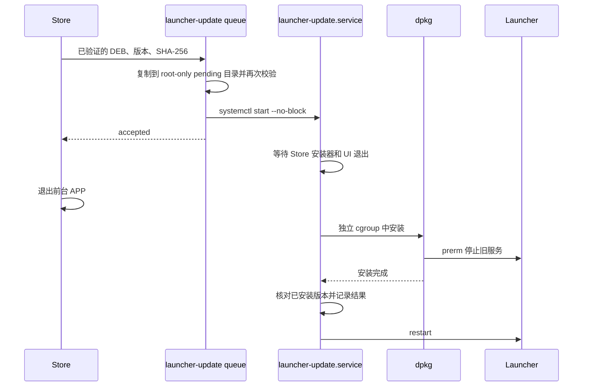
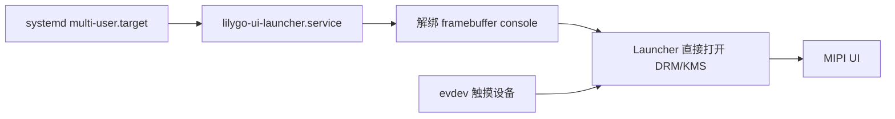
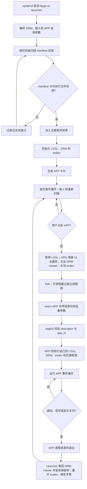

# Launcher 应用生命周期与显示交接设计

本文描述 `lilygo-ui-launcher` 在无桌面系统的目标板上，从 systemd 启动、发现 APP、
响应点击、启动独立进程到恢复首页的实际流程。Launcher 与 APP 是独立进程；安装
manifest 是运行时发现协议，不表示 APP 依赖 Launcher 源码或软件包。

## 目标与约束

Launcher 负责应用发现、前台进程调度和首页恢复；AppKit 负责各应用进程内的 LVGL、
显示、输入与公共界面生命周期。设计必须同时满足以下要求：

- 同一时刻只有一个前台 APP 驱动直接显示设备；Launcher 在交出显示前停止绘制。
- 应用正常退出、启动失败或被信号终止后，都进入相同的首页恢复流程。
- DRM/EGL 支持资源保留时减少重建成本；不支持或交接失败时保留完整重建路径。
- DRM 交接等待有界；缓冲、输入和手势回调的所有权不能跨显示代际悬空。
- APP 保持独立进程与地址空间，不共享 Launcher 的 LVGL 对象、纹理或业务状态。

渲染器、旋转缓冲和私有 Mesa 的选择见 [图形渲染设计](graphics-rendering.md)；
源码 SDK 与运行时包边界见 [SDK 与打包设计](sdk-packaging.md)。

## 生产环境启动

目标镜像不启动 display manager、桌面环境或 compositor。Debian 包安装后将默认
target 设置为 `multi-user.target`，屏蔽 `getty@tty1.service`，并启用：

```sh
/usr/bin/lilygo-ui-launcher --display drm --drm /dev/dri/card0 \
  --input /dev/input/by-path/platform-3f205000.i2c-event
```

`lilygo-ui-launcher.service` 直接占用 DRM/KMS 和 evdev。服务启动前，
`lilygo-ui-launcher-console acquire` 暂时解绑 framebuffer console，避免内核控制台与
Launcher 同时写显示设备；服务退出后再执行 `release` 恢复绑定。Launcher 和 APP
的 stdout/stderr 均由 journald 收集。

安装脚本在 `/var/lib/lilygo-ui-launcher` 记录安装前的默认 target、已启用的
display manager 和由本包屏蔽的 getty。卸载软件包时会停用 Launcher 服务并恢复
这些状态。软件包不安装 XDG autostart 或桌面菜单入口。

## Store 升级 Launcher

Store 是 Launcher 启动的前台子进程，两者都位于
`lilygo-ui-launcher.service` 的 cgroup 中。Launcher 的旧版本 `prerm` 在升级时会
停止该服务，因此 Store 不能在自己的进程树中同步执行 Launcher 的 `dpkg --install`。

升级使用以下交接流程：



Store 的调用协议是：

```sh
pkexec /usr/lib/lilygo-ui-launcher/lilygo-ui-launcher-update \
  queue DEB VERSION SHA256
```

只有 helper 返回成功后 Store 才退出。helper 持久化 DEB 后异步启动
`lilygo-ui-launcher-update.service`；如果调用者是 Store 的特权安装进程，worker 会先
等待安装器和 Store UI 退出，避免停止旧 Launcher 服务时连带终止 Store；等待超时则放弃安装。
worker 随后再次校验 SHA-256、包名、版本、架构以及
目标版本必须高于已安装版本。worker 设置
`LILYGO_UI_LAUNCHER_UPDATE_HELPER=1` 调用 `dpkg`，使 `postinst` 不在包事务中提前
重启 Launcher；worker 在 `dpkg` 返回并核对安装版本后负责最终重启。失败时也会尝试
恢复 Launcher，并将结果写入 `/var/lib/lilygo-ui-launcher/last-update` 和 journald。

`lilygo-ui-launcher` 是不可卸载的系统组件。Store 必须隐藏其 Remove 操作，并将它的
安装更新分派给上述 helper。软件包使用 `Priority: required`，且 `prerm` 默认拒绝
remove/deconfigure；只有明确设置 `LILYGO_UI_LAUNCHER_ALLOW_REMOVE=1` 的管理员维护
操作才会执行卸载。首次引入 helper 的基线版本不能通过尚未具备该机制的旧
Store/Launcher 进程树自举，应由系统镜像或管理员部署一次。



## 总体流程



上图展示支持显示交接的 DRM/EGL 路径。软件 DRM、旧 SDK，或交接失败时采用
删除显示和 UI、应用退出后重新创建的兼容路径。

## APP 发现

Launcher 依次扫描以下来源，先发现的同 ID 应用优先：

1. `LAUNCHER_APP_DIRS` 中以冒号分隔的目录；
2. `--app-dir` 指定目录；
3. `$XDG_DATA_HOME/launcher/apps`，或 `$HOME/.local/share/launcher/apps`；
4. `/usr/local/share/launcher/apps`；
5. `/usr/share/launcher/apps`。

manifest 必须是普通 `.json` 文件，包含 `schema_version`、合法的 application ID、
显示名和可执行路径；`order` 可选，默认值为 `0`。独立 APP 包应将 128x128 PNG 安装到
`/usr/share/icons/hicolor/128x128/apps/<application-id>.png`，并通过 `icon`
字段填写绝对路径或相对 manifest 的路径。图标未提供、文件不可读或 PNG 无法识别时，
Launcher 显示内置默认图标，但仍正常发现和启动 APP。可执行文件必须存在、是普通文件
并具有执行权限。首页停留期间每 2 秒清理已消失的应用并重新扫描，安装或卸载独立
APP 包不需要重启 Launcher。

## 进程启动协议

Launcher 刷新当前帧后暂停 LVGL timer。支持显示交接的 DRM/EGL 后端先等待
尚未完成的 page flip，再交出 DRM master；保留 Launcher 的 UI、EGL 上下文、
纹理缓存、GBM surface 和最后呈现的 framebuffer。最后呈现的 GBM buffer 继续
保持锁定，确保 APP 保存的恢复目标在运行期间仍然有效。随后关闭 Launcher 的
evdev，避免 APP 运行期间的触摸积累到返回后的事件队列，再执行 `fork()`。

软件 DRM、旧 SDK、`LILYGO_UI_DRM_RECREATE=1` 或暂停交接失败时，启动前仍会
删除 Launcher UI 和 DRM display。子进程建立独立进程组并直接
`execv()` manifest 指定的文件，不经过 shell。父进程以非阻塞 `waitpid()` 等待，
因此同一时刻只运行一个前台 APP。显示缓存保留在 Launcher 进程中；APP 仍是每次
启动的新进程，需要初始化自己的运行时与页面。

传给 APP 的参数如下：

| 参数 | 来源和用途 |
| --- | --- |
| `--app-id` | manifest 的 `id`；AppKit 确认它与 descriptor 的 `id` 相同 |
| `--app-name` | manifest 的 `name`；为启动协议兼容保留，当前不显示 |
| `--display` | `drm`、`fbdev`，或开发机上的 `sdl` |
| `--width`, `--height` | 旋转前的竖屏基准画布，必须满足 `width < height`，默认 `568x1232` |
| `--orientation` | 当前显示方向：`portrait` 或 `landscape` |
| `--drm`, `--drm-connector` | DRM 设备节点及可选 connector ID |
| `--fbdev` | framebuffer 设备节点 |
| `--input` | evdev 输入设备节点 |

`execv()` 保留 Launcher 的环境变量、当前工作目录、用户/组、标准输入输出和未设置
close-on-exec 的文件描述符。当前实现没有额外权限降级、namespace、seccomp 或
cgroup 限额；APP 以 Launcher 服务的权限访问设备和文件。

## APP 生命周期

每个 APP 编译源码 SDK 生成的 `main` 入口，并静态链接 LILYGO UI AppKit/LVGL
运行代码。`main` 调用 `cm0_app_run()`，其顺序为：

1. 解析 Launcher 传入的参数；
2. 校验 descriptor API 版本、结构大小、`id` 和 `open` 回调；
3. 初始化 LVGL，并直接创建 DRM/fbdev 与 evdev 对象；
4. 在 `lv_layer_top()` 创建公共状态栏和 home indicator，并创建内容根对象与底部上划退出手势；
5. 调用 APP 的 `open()`；APP 可使用 LVGL API 创建或加载独立 screen，顶层 system chrome 不随 screen 切换；
6. 底部上划、`request_exit()`、`SIGINT`、`SIGTERM` 或显示删除结束循环；
7. 调用可选的 `close()`，删除显示并调用 `lv_deinit()`。

Launcher 和 APP 各有一份 LVGL 全局状态及地址空间。它们不能同时提交到同一个
直接显示设备，因此 DRM 生产路径明确交接 master。保留 Launcher 的 EGL 上下文
不表示它在后台继续绘制，也不表示 APP 与 Launcher 共享 LVGL 对象或纹理。

APP 退出后，Launcher 重新取得 DRM master，先将保留的 framebuffer 绑定回
自己的 connector、CRTC 和显示模式，再重新打开 evdev、绑定下拉面板手势并恢复
timer 与刷新。首页控件和纹理无需重建。保留的原始 CRTC 状态只在 Launcher 最终
退出时用于恢复，不会被 APP 的状态覆盖。若恢复失败，Launcher 删除已暂停的显示
并走完整重建路径；暂停状态下清理不会向其他 DRM master 提交 CRTC 恢复操作。

## 显示与输入所有权

| 后端 | Launcher 启动 APP 前 | APP 使用的资源 | APP 退出后 |
| --- | --- | --- | --- |
| DRM/EGL，支持显示交接 | 暂停 timer，完成 page flip，交出 master；关闭 evdev，保留 UI、EGL 与显示缓冲 | 打开指定 DRM card、connector 和 evdev，取得 master | 取回 master、呈现保留帧；重开 evdev、重新绑定手势并恢复 timer |
| 软件 DRM、旧 SDK 或强制重建 | 删除 evdev、Launcher UI 和 DRM display | 打开指定 DRM card、connector 和 evdev | 重新打开 DRM、evdev 并重建 UI |
| SDL 模拟器 | 保留 SDL display，隐藏 Launcher 窗口 | APP 创建独立 SDL 窗口和鼠标输入 | 显示并前置 Launcher 窗口 |
| fbdev | 暂停 LVGL timer，当前实现保留 Launcher display/input | APP 再次打开 framebuffer 和 evdev | 重新启用 timer 并重绘 |

fbdev 只作为兼容诊断路径。若设备或驱动不允许两个已打开的客户端，需要为它补充
与 DRM 相同的释放和恢复流程。

### DRM 交接状态与恢复不变量

`DisplaySession` 将显示、输入和 UI 作为一个生命周期单元管理；主循环在运行 APP
前后成对调用 `suspend()` 和 `resume()`，包括 `fork` 或 `exec` 失败的情况。

| 状态 | Launcher 持有的资源 | 转移条件 |
| --- | --- | --- |
| 首页活动 | 显示、UI、evdev，启用 LVGL timer | 收到有效启动请求，完成当前帧后暂停 |
| 显示保留并暂停 | UI、EGL、纹理、GBM 与已呈现缓冲；关闭 evdev，交出 master | APP 退出后尝试取回 master 并恢复 framebuffer |
| 显示已释放并暂停 | 保存方向与注册表；删除 UI、输入与 DRM display | APP 退出后重新创建显示、输入和 UI |
| 恢复失败 | 按所有权清理本次资源 | 取回 master 失败先转完整重建；重建失败退出，由服务策略处理 |

保留路径必须锁定最后呈现的 GBM buffer，使 APP 保存的恢复目标在整个运行期间有效。
恢复时呈现 Launcher 的保留帧；Launcher 最初保存的 CRTC 状态只用于最终退出。
暂停状态销毁资源不能向其他 master 提交 CRTC 恢复。

重新打开 evdev 后必须把保留 UI 的手势回调绑定到新输入对象。完整重建则先删除 UI
回调，再删除显示；显示或输入被外部删除时，删除事件必须清空所有者指针。
软件 DRM 重建后需要刷新两次以初始化两个 scanout buffer；EGL 保留完整纹理时只需
最终刷新。这些差异由 `DisplaySession` 封装，不由主循环或 APP 猜测。

## 资源与依赖

| 类别 | 资源 |
| --- | --- |
| 进程 | 一个常驻 Launcher；运行 APP 时增加一个独立进程组 |
| 内存 | 最多 128 项的固定注册表；Launcher 与 APP 各自使用 8 MiB LVGL heap；GPU、字体和图像缓存等另计 |
| 显示 | 设备端 Linux DRM/KMS 或 fbdev；开发机 SDL 窗口 |
| 输入 | 设备端 Linux evdev；开发机 SDL mouse |
| UI | 静态链接 AppKit 和 LVGL 9.5.0，并通过 `lilygo_ui_font_get()` 使用 `lilygo-ui-appkit-dev` 提供的复合字体 |
| 信号 | Launcher 处理 `SIGINT`/`SIGTERM`；停止时先向 APP 进程组发 `SIGTERM`，3 秒后发 `SIGKILL` |
| 日志 | Launcher 和 APP 写 stderr，由 systemd-journald 收集 |

软件 DRM 后端需要 `libdrm`；GPU 后端还需要 GBM、EGL 和 GLES2 运行库。
设备端不构建或链接 Wayland、layer-shell、
xdg-shell 或 xkbcommon。复合字体栈还需要 FreeType、PNG、zlib、bzip2 和
Brotli 运行库。主机模拟器使用 SDL2。APP 可声明自己的硬件或媒体库依赖。

保留显示会让 Launcher 的 UI 和 GPU 缓存在 APP 运行期间继续占用内存；相较于
每次销毁显示，需要评估 Launcher 与实际 APP 同时存活时的内存峰值和系统可用内存。
这部分占用不能仅由 LVGL heap 大小估算。

## 切换耗时诊断

日志中的 `switch prepared` 记录从处理启动请求到开始启动子进程的 `release_ms`；
`switch restored` 的 `restore_ms` 记录从父进程观察到 APP 退出到恢复 UI 的耗时。
`retained=1` 表示使用了保留显示路径，`retained=0` 表示使用兼容路径。这些时间
不包含完整的触摸输入延迟，也不等于 APP 首帧或面板实际显示时间。

可以在相同程序和场景下设置 `LILYGO_UI_DRM_RECREATE=1` 强制旧的销毁、重建流程，
用于对比耗时、定位问题和评估内存差异；不设置该变量时默认尝试保留显示。
手动运行时，应先停止占用 DRM 的 Launcher 服务：

```sh
sudo systemctl stop lilygo-ui-launcher
sudo env LILYGO_UI_DRM_RECREATE=1 /usr/bin/lilygo-ui-launcher \
  --display drm --drm /dev/dri/card0 \
  --input /dev/input/by-path/platform-3f205000.i2c-event
# 手动程序退出后恢复服务
sudo systemctl start lilygo-ui-launcher
```

暂停时的 page flip 等待最多约 1 秒；恢复 master 最多重试 100 次，每次间隔
10 ms。遇到异常时会返回失败并走兼容恢复路径，不会无限等待。完整重建仍沿用
显示初始化时的 master 获取策略。实际切换收益需以板端日志测量为准。

### 性能依据与比较口径

保留显示直接减少返回时 UI、上下文和缓存的重建成本；新 APP 仍需初始化自己的
图形环境。2026-09-17 的方案因此同时采用显示保留和私有 VC4 Mesa 来降低进入与
返回等待，而非仅靠保留 Launcher 资源。该次横竖屏合并中位数如下，单位为 ms：

| 应用 | 进入：基线 → 优化后 | 返回：基线 → 优化后 |
| --- | ---: | ---: |
| Settings | 837 → 333 | 842 → 88 |
| Files | 784 → 220 | 659 → 81 |
| Meshtastic | 487 → 253 | 546 → 72 |

基线每个应用 4 次，最终方案每个应用 6 次；进入从模拟点击抬起计至 AppKit 首次
`lv_refr_now()` 后的就绪标记，返回从发送 SIGTERM 计至 Launcher 恢复就绪标记。
日志轮询间隔 10 ms。这与 `release_ms`、`restore_ms` 的起止点不同，也不是光学
输入到显示延迟。隔离 XDG、空文件目录和回环网络等条件及完整材料见
[历史优化记录](archive/app-switch-latency-2026-09-17.md)。这些数字是方案依据，
不作为所有应用的固定性能保证，也不代表后续构建已重新测量。

## 错误与恢复

- manifest 无效、可执行文件缺失或不可执行：发现阶段跳过并写日志；
- `fork()` 失败：Launcher 记录启动失败并恢复首页；
- `execv()` 失败：子进程写 stderr 并以 `127` 退出；
- AppKit 参数或 descriptor 不兼容：APP 以 `2` 退出；
- APP 无法初始化显示：APP 以 `1` 退出；
- APP 被信号终止：Launcher 将结果转换为 `128 + signal`；
- DRM/EGL 暂停交接失败：启动前回退到删除 UI、显示的兼容流程；
- DRM/EGL 恢复失败：记录告警并重新创建显示与 UI；重建也失败则退出，由服务策略处理；
- APP 退出后：Launcher 恢复 DRM、evdev 和手势绑定，刷新 UI 并恢复目录扫描。

## 验证要求

| 设计性质 | 验证方式 |
| --- | --- |
| 资源所有权和恢复分支 | 主机 `launcher-display-session` 覆盖软件、支持交接的 EGL、缺少交接 API 的旧 SDK，检查输入重新绑定、恢复失败与外部删除 |
| DRM/GBM 交接正确性 | AppKit 驱动测试覆盖保留 framebuffer、有限等待、失败回退与暂停销毁；板端覆盖保留和强制重建两条路径 |
| APP 异常不阻断首页恢复 | 板端临时子进程覆盖正常退出、非零退出、信号终止与 exec 失败 |
| 真实交互及重复重建 | 真实应用在横竖屏下重复启动，以 SIGTERM 和底部上滑退出，检查首帧、返回、进程存活与服务重启次数 |
| 软件旋转缓冲可靠性 | AppKit 受限分配器与映射失败回归，并结合真实 UI、字体与图标反复重建，防止轻量子进程掩盖缓存碎片问题 |

执行入口及测量解释见 [硬件测试指南](../tests/README.md)。涉及软件整帧缓冲的
原因与内存策略见 [图形渲染设计](graphics-rendering.md)，当次复现及 80 次真实应用
验证见 [返回缓冲修复记录](archive/launcher-return-buffer-fix-2026-09-22.md)。主机 mock
验证控制流，板端日志验证软件就绪；两者都不能替代物理画面与输入到显示延迟测量。

## 代码索引

`DisplaySession` 统一持有 Launcher 的显示、输入和 UI。主循环只负责调用
`suspend()`、运行前台 APP，再调用 `resume()`；显示重建和保留资源恢复共用同一套
初始化与清理逻辑。输入和显示的删除事件会清空所有者指针，覆盖 SDL 主动关闭等路径。

- 启动、发现、前台 APP 调度和信号：[`src/main.cpp`](../src/main.cpp)
- 显示、输入和 UI 所有权，方向设置、交接和恢复：[`src/display_session.cpp`](../src/display_session.cpp)
- manifest 解析：[`src/manifest.cpp`](../src/manifest.cpp)
- 目录扫描、校验和排序：[`src/registry.cpp`](../src/registry.cpp)
- `fork`、`execv`、等待和信号升级：[`src/process.cpp`](../src/process.cpp)
- APP 独立 LVGL 生命周期：由独立的 `LilyGoUI` SDK 提供
- AppKit 构建配置：由 `find_package(LilyGoUI CONFIG REQUIRED)`
  导入当前仓库的源码子模块并静态编译；公共字体由 `lilygo-ui-appkit-dev` 提供
- 生产 DRM 服务：[`packaging/systemd/lilygo-ui-launcher.service`](../packaging/systemd/lilygo-ui-launcher.service)
- Store 升级 helper：[`packaging/systemd/lilygo-ui-launcher-update`](../packaging/systemd/lilygo-ui-launcher-update)
- 独立升级服务：[`packaging/systemd/lilygo-ui-launcher-update.service`](../packaging/systemd/lilygo-ui-launcher-update.service)
- Debian 安装迁移：[`packaging/debian/postinst`](../packaging/debian/postinst)
- 主机交接回归与板端验证入口：[`tests/README.md`](../tests/README.md)
