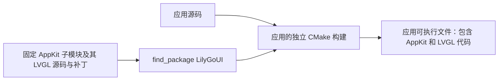

# SDK、软件包与发布边界设计

LILYGO UI 以独立应用仓库和源码 SDK 组成。每个应用固定 AppKit 源码版本，
将 AppKit 与 LVGL 静态编译进自己的可执行文件；公共字体由
`lilygo-ui-appkit-dev` 统一安装。本文定义构建输入、包归属和升级边界，
具体包版本以各仓库的发布元数据为准。

Launcher 与应用之间的发现和进程协议见
[应用生命周期](launcher-app-lifecycle.md)，渲染器及 Mesa 的选择见
[图形渲染设计](graphics-rendering.md)。

## 设计目标与仓库边界

每个应用必须能够独立配置、构建、测试和打包。一份应用仓库对应一个稳定应用 ID、
一个应用可执行文件和一个 Debian 包，仓库名称采用对应的 Debian 包名。
Launcher 只构建、测试和打包自身；不添加应用子目录，也不访问应用私有源码。

AppKit 是独立的顶层 CMake 工程。应用通过固定源码子模块和
`find_package(LilyGoUI CONFIG REQUIRED)` 消费 SDK，不依赖 Launcher 源码、
Launcher CMake 函数或其他应用仓库。安装到 `/usr/share/launcher/apps` 的
manifest 是运行时发现协议，不构成对 Launcher 包的依赖。

这一边界使应用可以按各自发布节奏更新，同时将所用的 SDK 实现固定在构建输入中。
代价是 SDK 实现修复必须重新构建并发布受影响的应用；仅升级设备上的 dev 包，
不会替换已经编入应用的 AppKit 或 LVGL 代码。

## 源码 SDK 与构建输入

正常构建由应用的 CMake preset 将 `LilyGoUI_DIR` 指向固定的
`third_party/cm0-appkit` 子模块。SDK 的公共目标包括 `LilyGoUI::LVGL`、
`LilyGoUI::UIFonts`、`LilyGoUI::SystemStatus`、`LilyGoUI::StatusBar` 和
`LilyGoUI::Runtime`；消费者按需要链接这些目标，不直接包含 SDK 的私有实现文件。

AppKit 也可安装为独立的源码 SDK；显式选用该 SDK 时仍然在应用构建中静态编译，
不能将它误认为预编译的 AppKit 二进制 SDK。发布时应记录实际使用的 AppKit 修订、
工具链和渲染配置，避免子模块与显式指定的源码目录产生来源歧义。

| 构建环境 | 必需输入 | 依赖边界 |
| --- | --- | --- |
| 主机模拟器 | 构建工具、LPM、SDL2、FreeType、AppKit 源码 | 使用源码目录中的字体；无需安装 AppKit 二进制 SDK |
| CM0 软件渲染 | BSP 编译器及 sysroot、AppKit 源码 | BSP 提供 DRM、FreeType 等普通平台依赖 |
| CM0 GPU 渲染 | 上述输入及匹配目标的 EGL、GBM、GLES 开发文件 | 选用包含 GPU 集成的 SDK；系统图形库不属于 AppKit 二进制 SDK |

Launcher 的默认 preset 从源码子模块构建。SDK 默认软件渲染以适配基础 BSP；
GPU 构建使用单独目录和具备相应图形依赖的 sysroot，详细条件见
[图形渲染设计](graphics-rendering.md)。构建目录若曾使用动态 SDK，应清理旧 CMake
缓存后重新配置；LVGL 补丁变化时也要确认生成的源码树已更新，必要时使用全新构建目录。

## 软件包与共享资源归属

| 内容 | 所有者 | 更新后的生效方式 |
| --- | --- | --- |
| AppKit/LVGL 实现代码 | 各应用可执行文件 | 更新固定源码并重新构建、部署应用 |
| 源码 CMake SDK、头文件、LVGL 归档与补丁 | `lilygo-ui-appkit-dev` | 供显式使用已安装源码 SDK 的构建消费 |
| Inter、Source Han Sans CN、Font Awesome 完整公共字体及许可证 | `lilygo-ui-appkit-dev` | 应用运行时从公共字体目录读取 |
| 应用私有资源、配置模板及补充字体 | 对应应用包 | 随该应用发布，不复制 AppKit 公共字体 |
| DRM、FreeType、EGL、GBM、GLES 等平台库 | 普通系统包或独立图形运行库 | 按各自动态库和包依赖规则更新 |

`lilygo-ui-appkit-dev` 是架构无关的源码和资源包，不安装 AppKit/LVGL 共享库，
也不提供动态 AppKit ABI capability。应用依赖该包是为了取得共享字体，最低版本
必须与其所需资源一致；Launcher 的最低版本由 `lpm.toml` 声明并用于生成 Debian
依赖。公共字体安装到 `/usr/share/lilygo-ui/fonts`，许可证随 SDK 和字体分发。

公共字体的存储预算由 AppKit 管理，应用不能另行捆绑完整副本。包含字体字形资产的
二进制分发保留 `NOTICE.md` 和 `OFL-1.1.txt`；Launcher 通过 SDK 的许可证安装函数
将其放入自身文档目录。字体选择、复合 fallback 和补充字形要求见
[UI 设计规范](ui-design-guidelines.md)，字体清单和预算见
[AppKit 字体说明](../third_party/cm0-appkit/assets/fonts/README.md)。

静态链接 AppKit 不要求整个应用成为完全静态的 ELF。应用仍直接声明并动态链接普通
系统依赖；OpenGLES 构建还需要 `libgbm1`、`libegl1`、`libgles2` 等运行库。
可选的私有 Mesa VC4 包提供图形驱动库，其源码与打包由
[独立 Mesa 仓库](https://github.com/LILYGO-UI/mesa-vc4)维护，服务启用由产品镜像
配置负责。它与 AppKit 共享库无关，
不能用“使用私有 Mesa”推断应用采用动态 AppKit。构建产物不应携带交叉 sysroot
派生的运行时库搜索路径；Launcher 已在 CMake 中关闭构建 RPATH。

## 稳定身份与安装边界

共享产品使用 `lilygo-ui` 包名前缀和 `cc.lilygo.ui` 命名空间；CM0 是产品配置，
不进入应用的公共身份。以组件 `<component>` 和桌面名称 `<Component>` 表示：

| 接口 | 形式 |
| --- | --- |
| Debian 包、应用可执行文件 | `lilygo-ui-<component>`、`/usr/bin/lilygo-ui-<component>` |
| 应用 ID | `cc.lilygo.ui.<Component>` |
| 桌面文件、图标和 AppStream ID | 使用同一个应用 ID，按格式添加文件扩展名 |
| D-Bus 名和 Wayland `app_id` | 在提供相应集成时沿用同一个应用 ID |
| systemd 服务 | `lilygo-ui-<component>.service` |

包名和应用 ID 是稳定接口。历史身份迁移需要明确计划，并通过 Debian 的
`Provides`、`Conflicts`、`Replaces` 表达替换关系，不能直接更名后留下旧文件或
依赖歧义。手机和桌面表现通常是同一应用的运行模式；独立身份的条件与完整命名规则
见 [项目约定](../AGENTS.md)。

应用私有库和资源分别位于 `/usr/lib/lilygo-ui-<component>/`、
`/usr/share/lilygo-ui-<component>/`；系统默认配置位于
`/etc/lilygo/ui/<component>.conf`，系统持久状态位于
`/var/lib/lilygo-ui-<component>/`。用户配置和数据遵循 XDG 目录，包升级不能将
用户数据当作包资源覆盖。服务日志写入 stdout/stderr，由 journald 收集。

Launcher 的身份为 `lilygo-ui-launcher` / `cc.lilygo.ui.Launcher`。
它作为主界面由 systemd 启动，当前包不安装应用菜单桌面入口；稳定的桌面文件命名
规则用于存在该集成的应用，不表示每个包都必须增加桌面入口。其服务接管、移除恢复
和 Store 更新流程见 [应用生命周期](launcher-app-lifecycle.md)。

## 构建、打包与验证

Launcher 的 `lpm.toml` 是开发者维护的包名、版本、应用 ID、最低 AppKit 版本和
发布元数据来源；`cmake/LpmMetadata.cmake` 在配置时调用 LPM 校验并导入，
不要另设一份需要手工同步的版本或身份常量。

正常开发入口为 `lpm start`、`lpm test`、`lpm pack`。AppKit 在自己的仓库独立
构建和打包，应用在各自仓库运行测试和打包；Launcher 的测试通过不代表其他应用或
AppKit 的测试已通过。

发布候选需要满足以下检查：

- 构建来源可追踪：记录应用和 AppKit 修订、工具链、渲染器、包版本及 SHA-256。
- 包元数据准确：核查架构、直接系统依赖、AppKit 最低依赖及必要的迁移关系。
- SDK 内容完整：源码、头文件、LVGL 归档、补丁、公共字体和许可证均存在；
  无 AppKit/LVGL 共享库、导入的共享库目标或旧动态 ABI capability。
- 应用边界正确：可执行文件没有 AppKit/LVGL 动态依赖，包内没有公共字体重复副本，
  不携带构建 RPATH；仍允许正常的平台动态依赖。
- 行为经过相应验证：主机测试覆盖代码和打包行为，设备测试核查实际渲染器、首帧、
  进程退出及显示恢复。硬件方法和计时局限见 [DRM 测试指南](../tests/README.md)。

AppKit 提供 [Debian 包检查器](../third_party/cm0-appkit/tests/test_debian_packages.py)，
可在具备 `dpkg-deb` 与目标 `readelf` 的环境核查 dev 包及多个应用包。该检查器属于
对应 SDK 版本，其版本相关断言应与候选包匹配；构建成功、ELF 检查通过或历史设备
报告均不能替代新候选版本的行为验证。

## 部署、升级与回退

一次部署以明确的软件包集合为单位。正式发布应递增包版本；内部测试若同版本重装，
必须同时记录包和已安装可执行文件的 SHA-256，避免只凭版本号误认构建。

1. 安装前核查已安装版本、包依赖、现有配置和服务环境，保留可重新安装的旧包及
   必要配置备份。先模拟 APT 事务，确认应用不会因依赖变化被意外移除。
2. 涉及 SDK 包拆分、合并或动态消费者迁移时，将相互依赖的包作为同一事务安装。
   按 Debian 版本比较处理升级或显式降级，不能用替换文件代替依赖迁移。
3. 安装后核对包状态、依赖、文件哈希、公共字体归属和 ELF 动态依赖，再验证服务
   状态、重启计数、实际库加载、首帧以及应用启动和返回。保留测试范围与结果。
4. 回退时核查旧包集合能否共同满足依赖，并恢复所需服务环境和配置；完成回退后
   重复包状态及运行验证。只复制旧程序或解压文件备份不会回退 dpkg 的依赖记录，
   不能视为完整的软件包回退。

旧的动态 AppKit 消费者必须先改为静态构建，再与当前 dev 包一同迁移。
dev 包对旧 runtime 包的兼容替换关系只用于包迁移，不提供已撤销的动态 ABI，
不能让未转换的动态应用继续运行。私有 Mesa 的启用由服务环境控制，迁移时应显式
核查它与候选图形包是否匹配，不能将 SDK 升级和驱动切换视为同一操作。

当前 SDK 的具体安装、迁移说明由
[AppKit 静态 SDK 文档](../third_party/cm0-appkit/docs/static-sdk.md)维护。

## 实现索引

- [Launcher 元数据](../lpm.toml)与 [LPM CMake 导入](../cmake/LpmMetadata.cmake)。
- [Launcher 构建与 Debian 元数据](../CMakeLists.txt)、[构建预设](../CMakePresets.json)
  和 [AppKit 子模块](../.gitmodules)。
- [AppKit CMake 配置](../third_party/cm0-appkit/LilyGoUIConfig.cmake)、
  [静态目标及字体集成](../third_party/cm0-appkit/CM0AppKit.cmake)和
  [SDK 打包规则](../third_party/cm0-appkit/CMakeLists.txt)。
- [项目约定](../AGENTS.md)、[UI 设计规范](ui-design-guidelines.md)和
  [应用生命周期](launcher-app-lifecycle.md)。
